<div align="center">

<a href="https://www.abdul-mannan.com/"></a>

<a href="https://www.abdul-mannan.com/"></a>
<a href="https://www.linkedin.com/in/mannan-software-engineer/"></a>
<a href="mailto:mannanforge@gmail.com"></a>
<a href="https://www.abdul-mannan.com/src/pdf/Abdul-Mannan-CV.pdf"></a>


</div>

<br/>

<table>
<tr>
<td width="55%" valign="top">

### `$ cat about.md`

I'm a **Senior Backend Developer** based in **Lahore, Pakistan**. I specialise in **FastAPI microservices** and the **Kubernetes clusters** that run them.

I started out in Selenium and Python automation. Today I design async services, ship them through CI/CD into Helm-managed releases, and keep them observable once they're live.

I've built peer-to-peer logistics, digital wallets with audit trails, **FBR e-invoicing** and real-time reservation systems for fintech, e-commerce and food-tech.

</td>
<td width="45%" valign="top">

### `$ python whoami.py`

```python
class AbdulMannan(Engineer):
    role     = "Senior Backend Developer"
    company  = "Crypthon Technologies"
    base     = "Lahore, PK · UTC+5"
    focus    = ["FastAPI", "Kubernetes",
                "Distributed systems"]
    building = "GrabnGo"

    def deploy(self, idea):
        return idea.containerize() \
                   .helm_upgrade() \
                   .monitor()
```

</td>
</tr>
</table>

### `$ ls ~/services`

<table>
<tr>
<td width="33%" valign="top">

**⚡ Backend architecture**

Async FastAPI and Django microservices, clean REST and WebSocket APIs, JWT / OAuth2 / RBAC, and Celery pipelines for background work.

</td>
<td width="33%" valign="top">

**☸️ Platform & DevOps**

Docker, Kubernetes and Helm with HPA and RBAC, plus GitHub Actions CI/CD from commit to cluster on AWS or bare-metal k3s.

</td>
<td width="33%" valign="top">

**📈 Reliability & scale**

Prometheus, Grafana, Loki and ELK observability, JMeter load testing, and query tuning that keeps p95 latency low.

</td>
</tr>
</table>




<div align="center">

<a href="https://grabngo.com.pk"></a>
<a href="https://laendaen.com"></a>
<a href="https://www.abdul-mannan.com/"></a>

</div>

<br/>

<div align="center">

### `$ kubectl describe toolbox`

<table>
<tr>
<td align="center" width="33%"><sub><b>LANGUAGES & FRAMEWORKS</b></sub><br/><br/></td>
<td align="center" width="33%"><sub><b>DATA</b></sub><br/><br/></td>
<td align="center" width="33%"><sub><b>CLOUD & DEVOPS</b></sub><br/><br/></td>
</tr>
<tr>
<td align="center"><sub><b>OBSERVABILITY & TESTING</b></sub><br/><br/><br/>


</td>
<td align="center"><sub><b>ASYNC & REAL-TIME</b></sub><br/><br/>


</td>
<td align="center"><sub><b>DELIVERY & SECURITY</b></sub><br/><br/>


</td>
</tr>
</table>

<br/>

### `$ git shortlog --activity`


<br/><br/>


<a href="https://www.linkedin.com/in/mannan-software-engineer/"></a>
<a href="mailto:mannanforge@gmail.com"></a>


</div>
