<div align="center">

<a href="https://www.abdul-mannan.com/"></a>

<a href="https://www.abdul-mannan.com/"></a>
<a href="https://www.linkedin.com/in/mannan-software-engineer/"></a>
<a href="mailto:mannanforge@gmail.com"></a>
<a href="https://www.abdul-mannan.com/src/pdf/Abdul-Mannan-CV.pdf"></a>


</div>

<br/>

<table>
<tr>
<td width="56%" valign="top">

### `~/about`

I'm a **Senior Backend Developer** at **Crypthon Technologies** in Lahore. I design **async FastAPI microservices** and run the **Kubernetes clusters** they live on.

I started out writing Selenium and Python automation. These days I take a service from schema to Helm chart to Grafana dashboard, then carry the pager for it.

Along the way I've shipped peer-to-peer logistics, **digital wallets with audit trails**, **FBR e-invoicing** and real-time reservation systems for fintech, e-commerce and food-tech.

</td>
<td width="44%" valign="top">

### `~/whoami.py`

```python
class AbdulMannan(Engineer):
    role  = "Senior Backend Developer"
    stack = ["FastAPI", "PostgreSQL",
             "Celery", "Kubernetes"]
    base  = "Lahore, PK · UTC+5"

    def ship(self, feature):
        return (feature
            .containerize()
            .helm_upgrade("prod")
            .observe())
```

</td>
</tr>
</table>







<div align="center">

<a href="https://grabngo.com.pk"></a>
<a href="https://laendaen.com"></a>
<a href="https://www.abdul-mannan.com/"></a>

<br/><br/>

### `~/toolbox`

<table>
<tr>
<td align="center" width="33%"><sub><b>BACKEND</b></sub><br/><br/></td>
<td align="center" width="33%"><sub><b>DATA</b></sub><br/><br/></td>
<td align="center" width="33%"><sub><b>CLOUD & DEVOPS</b></sub><br/><br/></td>
</tr>
<tr>
<td align="center"><sub><b>OBSERVABILITY</b></sub><br/><br/></td>
<td align="center"><sub><b>ASYNC & REAL-TIME</b></sub><br/><br/>


</td>
<td align="center"><sub><b>PLATFORM & SECURITY</b></sub><br/><br/>


</td>
</tr>
</table>

<br/>


<br/><br/>


<a href="https://www.linkedin.com/in/mannan-software-engineer/"></a>
<a href="mailto:mannanforge@gmail.com"></a>

</div>
